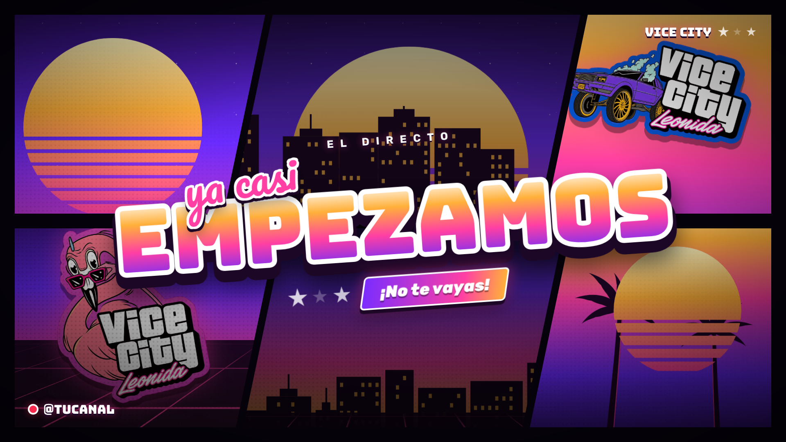

# Alertas GTA 6 · Vice City

🎁 Pack de alertas gratis, regalo para la comunidad de **[AlejoxCode](https://www.youtube.com/@alejoxcode)** y **[ArgeGaming](https://www.youtube.com/@argegaming)**.

## ⬇️ Descargar

### [👉 Descargar Alertas-GTA6-ViceCity.zip](https://github.com/alejox/gta6-alertas/raw/main/descargas/Alertas-GTA6-ViceCity.zip)

9 alertas animadas (seguidor, sub, resub, regalos, donación, raid, KICKs, bits y host) para **StreamElements** y **Streamlabs**, con stickers y sonidos. Funciona con Kick, Twitch y YouTube.

El zip incluye:
1. **Instalar en un clic (StreamElements)**: abre el HTML, pega tu JWT y listo.
2. **Manual**: el código para pegar en un Custom Widget, con los stickers y los sonidos.
3. **Streamlabs**: instalador en un clic y código manual.

Lee `LEEME.txt` dentro del zip para el paso a paso.

### 🎬 Versión video (fondo transparente + sonido)

### [👉 Descargar Alertas-GTA6-Video.zip](https://github.com/alejox/gta6-alertas/raw/main/descargas/Alertas-GTA6-Video.zip)

Las 9 alertas en **WebM (VP9) con canal alfa** y su sonido incluido: 1920x1080, 60 fps, ~7 s cada una. Sirven como fuente multimedia en OBS o como video de alerta en el alertbox de StreamElements o Streamlabs.

El recuadro del nombre va **vacío**, para que el nombre lo ponga StreamElements (o Streamlabs) con el texto de la alerta (`{name}`) colocado encima.

También se pueden bajar sueltos desde [`descargas/videos/`](descargas/videos). Para regenerarlos (otro nombre, otra resolución o MOV ProRes 4444 para Premiere/Final Cut) usa `video/render.js`; las opciones están al inicio del archivo.

### 🌴 Escenas (intro, pausa, vuelvo, salida, juego, hablar y transición)

### [👉 Descargar Alertas-GTA6-Escenas.zip](https://github.com/alejox/gta6-alertas/raw/main/descargas/Alertas-GTA6-Escenas.zip)

Escenas animadas 1920x1080 para OBS como fuente de navegador (`escenas/index.html?escena=intro&canal=TuCanal`), con textos editables desde la dirección, más una transición stinger en WebM transparente (punto de transición: 750 ms) y las versiones en PNG. Instrucciones en el `LEEME.txt` del zip.

---

Este repositorio aloja los recursos públicos (stickers y sonidos) que usan los widgets de StreamElements y Streamlabs del pack.

- `stickers/` — 9 stickers PNG con transparencia (uno por evento)
- `sonidos/` — 9 efectos MP3 (uno por evento)

| Evento | Sticker | Sonido |
|---|---|---|
| Seguidor | flamenco.png | seguidor.mp3 |
| Suscriptor | caiman.png | suscriptor.mp3 |
| Resub | sol.png | resub.mp3 |
| Subs regalados | avioneta.png | regalos.mp3 |
| Donación | manati.png | donacion.mp3 |
| Raid | lowrider.png | raid.mp3 |
| KICKs | palmera.png | kicks.mp3 |
| Bits | vi.png | bits.mp3 |
| Host | rstar.png | host.mp3 |

## Streamlabs

Instalación en un clic: https://streamlabs.com/profile/share/custom_widget/457073239/4b32285d0994737e295adecad9d4eae3
(elige "Crear un nuevo tema de widget" → Crear → Usar). El código del Custom Widget está en `streamlabs/`.
