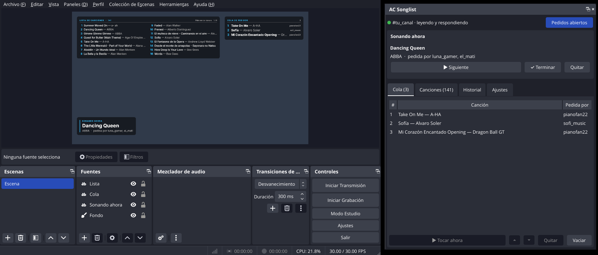
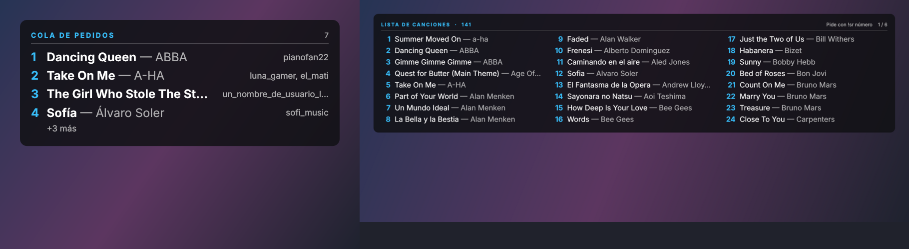

# AC Songlist · pedidos de canciones para OBS Studio

Plugin nativo de OBS (C++/Qt) para streamers que tocan en directo. Sin servicios externos:

1. **Tú armas la biblioteca** dentro de OBS, canción a canción o importando un CSV.
2. **Tu público elige**: escribe `!lista` para ver las canciones en pantalla y `!sr 12` o `!sr nombre` para pedir una.
3. **Cuando la tocas, se muestra** en el stream con una tarjeta minimalista de «Sonando ahora».




## Qué incluye

- **Panel acoplable** (menú *Paneles → AC Songlist*) con cuatro pestañas:
  - **Cola**: pedidos pendientes, quién los hizo, reordenar, quitar, *Tocar ahora*.
  - **Canciones**: alta rápida (título, Enter, artista, Enter), buscador sin acentos ni mayúsculas, categorías, editar, desactivar, importar y exportar CSV.
  - **Historial**: qué se tocó, cuándo y para quién.
  - **Ajustes**: canal de Twitch, límites de pedidos y respuestas en el chat.
- **Fuente de vídeo «AC Songlist»** para tus escenas, con tres modos:
  - *Sonando ahora*: la tarjeta de la canción actual, con fundido al cambiar.
  - *Cola de pedidos*: los siguientes pedidos y quién los pidió.
  - *Lista de canciones*: la biblioteca numerada, por páginas. Puede estar siempre visible o aparecer solo cuando alguien escribe `!lista`.
- **Estilo neutro y configurable** desde las propiedades de la fuente: tipografía, tamaño, colores de texto, acento y fondo, opacidad (0 = sin fondo), esquinas, márgenes, alineación, encabezado, filas y columnas.
- **Chat de Twitch** sin iniciar sesión para leer pedidos; opcionalmente una cuenta de bot para que conteste.
- **Atajos de teclado** en *Ajustes → Atajos*: siguiente canción, terminar la actual, abrir/cerrar pedidos, mostrar la lista.



## Instalación

Requiere **OBS Studio 30.2 o superior** (64 bits).

**Windows.** Descarga `AC-Songlist-Windows` desde la última ejecución de [Actions → AC Songlist](https://github.com/alejox/gta6-alertas/actions/workflows/ac-songlist.yml) (o desde *Releases* cuando haya una etiqueta publicada), descomprime y ejecuta `instalar.bat` con OBS cerrado. A mano: copia la carpeta `ac-songlist` a `C:\ProgramData\obs-studio\plugins\`.

**Linux.** Copia la carpeta `ac-songlist` del paquete a `~/.config/obs-studio/plugins/`.

Después abre OBS y activa el panel en *Paneles → AC Songlist*.

## Uso

1. **Biblioteca.** Pestaña *Canciones*: escribe título y artista y pulsa Enter. Cada canción recibe un número fijo, que es el que usa el público para pedirla.
2. **Chat.** Pestaña *Ajustes*: escribe tu canal de Twitch y pulsa *Guardar y conectar*.
3. **Overlay.** En tu escena, *Fuentes → + → AC Songlist*, y elige qué mostrar. Agrega la fuente tantas veces como quieras (por ejemplo, una para *Sonando ahora* y otra para la *Lista*).
4. **En directo.** Cuando vayas a tocar un pedido, pulsa **Siguiente** (o **Tocar ahora** sobre uno concreto). También puedes tocar una canción de la biblioteca sin que nadie la pida. Al acabar, **Terminar** o **Siguiente**.

### Comandos del chat

| Comando | Alias | Qué hace |
|---|---|---|
| `!sr <número o nombre>` | `!pedir`, `!request` | Pide una canción |
| `!lista` | `!canciones`, `!list` | Muestra la lista en pantalla |
| `!cola` | `!queue` | Dice los próximos pedidos |
| `!cancion` | `!song` | Dice qué suena ahora |
| `!siguiente` | `!next` | Dice cuál viene después |
| `!mipedido` | `!posicion` | Dice en qué puesto va tu pedido |
| `!quitar` | `!wrongsong`, `!ws` | Retira tu último pedido |
| `!abrir` / `!cerrar` | `!sropen` / `!srclose` | Abre o cierra pedidos (streamer y mods) |
| `!tocada` | `!srnext` | Termina la actual y pasa a la siguiente (streamer y mods) |
| `!saltar` | `!srskip` | Quita la actual sin contarla (streamer y mods) |

La búsqueda por nombre tolera acentos, mayúsculas, palabras sueltas y erratas pequeñas (`!sr sientist coldplay` encuentra *The Scientist*). Si dos personas piden la misma canción, la segunda se suma al pedido en vez de duplicarlo.

### Responder en el chat (opcional)

Para leer pedidos no hace falta nada más. Para que el plugin conteste («entró a la cola en el puesto 3»), pon en *Ajustes* una cuenta de Twitch y su token OAuth con permisos `chat:read` y `chat:edit`. El token se guarda en tu equipo, en el archivo de datos del plugin, sin cifrar (igual que OBS guarda tu clave de retransmisión): no compartas ese archivo.

### Importar canciones (CSV)

Botón **CSV → Importar**. Acepta:

- Un CSV con cabeceras `title`/`título`, `artist`/`artista` y, opcionalmente, `attributeNames`/`categorías`, `active`, `timesPlayed`, `lastPlayed`, `comment`. Es el formato que exporta **StreamerSonglist**, así que migrar desde ahí es exportar allí e importar aquí.
- Un CSV sin cabeceras: título, artista, categorías.
- Texto plano con una canción por línea: `Título - Artista`.

Las canciones repetidas (mismo título y artista) no se duplican.

## Dónde se guardan los datos

- Windows: `%APPDATA%\obs-studio\plugin_config\ac-songlist\songlist.json`
- Linux: `~/.config/obs-studio/plugin_config/ac-songlist/songlist.json`

Biblioteca, cola, historial y ajustes van en ese archivo. Reinstalar o actualizar el plugin no lo toca.

## Compilar

```bash
sudo apt-get install cmake ninja-build g++ libobs-dev qt6-base-dev
```

```bash
cmake -S . -B build -G Ninja -DACSL_BUILD_TESTS=ON
```

```bash
cmake --build build
```

```bash
QT_QPA_PLATFORM=offscreen ./build/acsl-tests
```

En Windows lo compila [el flujo de GitHub Actions](../.github/workflows/ac-songlist.yml), que arma un SDK mínimo de OBS (cabeceras de la versión 30.2.3 y librerías de importación generadas desde los `.dll` oficiales) y enlaza con Qt 6.6.

### Estructura

| Carpeta | Contenido |
|---|---|
| `src/core/` | Biblioteca, cola, búsqueda, CSV y comandos de chat. Solo QtCore, con pruebas. |
| `src/chat/` | Cliente del chat de Twitch (IRC). |
| `src/overlay/` | Dibujado del overlay y la fuente de vídeo de OBS. |
| `src/ui/` | Panel acoplable. |
| `tests/` | Pruebas del núcleo y generador de imágenes de muestra. |

## Límites conocidos

- Solo lee el chat de **Twitch** (no Kick ni YouTube).
- No tiene página web pública de la lista: el público la ve en el stream con `!lista`.
- Probado dentro de OBS 30 en Linux. La versión de Windows se compila y pasa las pruebas del núcleo en GitHub Actions, pero no se ha ejecutado dentro de OBS en Windows antes de publicarla aquí: si algo falla al cargarlo, el registro de OBS (*Ayuda → Archivos de registro*) lo dirá en las líneas `[ac-songlist]`.
